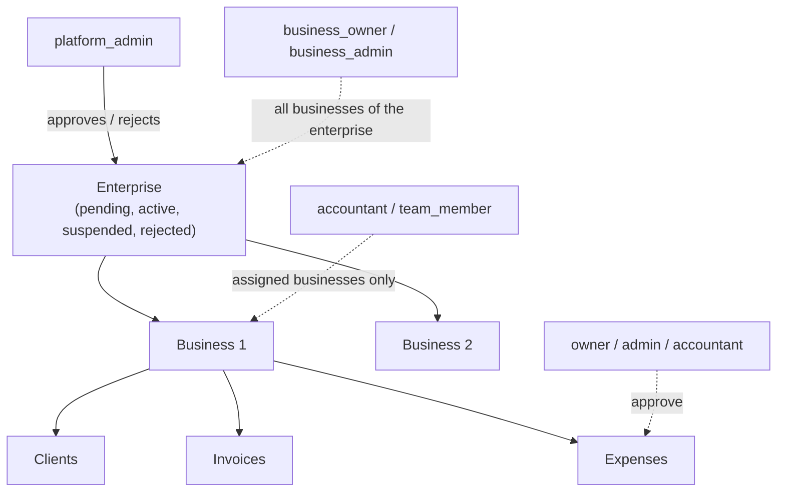

# NovaInvoice

**Invoicing, expense tracking and financial reporting for Tunisian SMEs — multi-enterprise, multi-business, role-based.**


<!-- TODO: add docs/screenshots/dashboard.png -->

NovaInvoice is a full-stack SaaS portfolio project. An **enterprise** (the SaaS customer) owns one or more **businesses**; each business manages its own clients, invoices and expenses. Defaults are tailored to Tunisia: currency **TND**, **19 % VAT**, and a *matricule fiscal* (tax ID) collected at registration. The UI is in English.

---

## Features

- **JWT authentication** — register, login, logout, access + refresh tokens (bcryptjs-hashed passwords and refresh tokens).
- **Multi-enterprise / multi-business** — one enterprise, several businesses, switchable from the UI.
- **Enterprise validation** — new enterprises start as `pending` and must be approved by a platform admin.
- **Clients** — create, edit, search, delete; client detail page with billing history and outstanding balance.
- **Invoices** — line items, VAT, statuses (`draft`, `sent`, `pending`, `paid`, `overdue`), mark as sent / paid, **PDF export** (jsPDF) and CSV export.
- **Expenses** — 13 categories, **approval workflow** (`pending` → `approved` / `rejected`, with approver and timestamp).
- **Reports & charts** — revenue chart, expenses by category, profit & loss (Recharts).
- **Team & roles** — create members, invite, assign members to specific businesses, 6 roles.
- **AI insights (optional)** — 3-point financial health summary of a business's invoices, generated **server-side** with Google Gemini.

## Roles & permissions

Access to every business-scoped endpoint (clients, invoices, expenses, AI, `GET`/`PUT /businesses/:id`) is enforced by `BusinessAccessGuard`:

| Role | Business access | Approve expenses | Manage team | Notes |
|---|---|---|---|---|
| `platform_admin` | All businesses | — | — | Approves / rejects enterprises (UI); any status via the API |
| `business_owner` | All businesses of **their enterprise** | ✅ | ✅ | Only role allowed to request AI insights |
| `business_admin` | All businesses of **their enterprise** | ✅ | ✅ | |
| `accountant` | **Only businesses assigned** to them (active link) | ✅ | — | |
| `team_member` | **Only businesses assigned** to them (active link) | ❌ | — | |
| `client_external` | ❌ Denied (403) | ❌ | — | |

Additional rules:

- If the business's enterprise is not `active` (e.g. still `pending`), access is denied with **403** for everyone except `platform_admin`.
- Unknown business → **404**. A resource (`:id`) that does not belong to the requested business → **404**.
- `GET`/`PUT /enterprises/:id` and `GET /businesses/enterprise/:enterpriseId` → **403** outside the user's own enterprise.

## Security

- **API-level multi-tenant isolation** — enforced by guards on the server, not just hidden in the UI. Covered by 31 unit tests (`npm test` in `backend/`) and verified manually end to end: a user from enterprise B gets 403 on every client, invoice, expense, enterprise and business endpoint of enterprise A.
- **AI key stays on the server** — `GEMINI_API_KEY` is a backend variable only; nothing is injected into the frontend bundle. Without a key, the AI endpoint returns `503 AI disabled`.
- Global `ValidationPipe` with `whitelist` + `forbidNonWhitelisted`, UUID validation on route params.

Known limitations are listed in the [Roadmap](#roadmap).

## Tech stack

| Layer | Technologies |
|---|---|
| Backend | NestJS 10, TypeScript, TypeORM 0.3, PostgreSQL, Passport JWT, bcryptjs, class-validator, Swagger, `@google/genai` |
| Frontend | React 19, Vite 6, TypeScript, React Router 7 (HashRouter), Zustand 5, react-hook-form + Zod, Recharts, jsPDF, lucide-react, Tailwind (CDN) |
| Tests | Jest + ts-jest (unit tests with mocked repositories) |

## Architecture

```
.
├── backend/              # NestJS REST API  (/api/v1, Swagger at /api/docs)
│   └── src/
│       ├── common/       # decorators, enums, guards (RolesGuard, BusinessAccessGuard)
│       ├── modules/      # auth, user, enterprise, business, team, client, invoice, expense, ai
│       └── scripts/      # seed-admin.ts
├── frontend/             # React + Vite SPA (atomic design)
├── CONTRIBUTING.md
└── LICENSE
```



## Getting started

### Prerequisites

- **Node.js 18+** (tested with Node 26) and npm
- **Docker** (recommended) or a local **PostgreSQL** server

### 1. Start PostgreSQL

```bash
docker run --name novainvoice-db \
  -e POSTGRES_USER=postgres -e POSTGRES_PASSWORD=postgres -e POSTGRES_DB=novainvoice \
  -p 5432:5432 -d postgres:16

docker exec novainvoice-db pg_isready -U postgres   # → accepting connections
```

### 2. Install dependencies

```bash
cd backend && npm install
cd ../frontend && npm install
```

### 3. Configure the backend

```bash
cd backend
cp .env.example .env
```

Edit `backend/.env`: set `DB_PASSWORD=postgres` (to match the container above), replace `JWT_SECRET` / `JWT_REFRESH_SECRET` with two different long random strings, and choose `ADMIN_EMAIL` / `ADMIN_PASSWORD`. For example, to generate a secret:

```bash
node -e "console.log(require('crypto').randomBytes(48).toString('base64url'))"
```

Keep `NODE_ENV=development`: the database schema is created automatically by TypeORM `synchronize` in this mode (there are no migrations yet).

### 4. Create the platform admin

```bash
npm run seed:admin
```

This creates a `platform_admin` from `ADMIN_EMAIL` / `ADMIN_PASSWORD` (it also creates the schema on a fresh database, since it boots the app in `development` mode). Running it again does nothing if the user already exists.

### 5. Run the apps

```bash
# terminal 1 — API on http://localhost:3000/api/v1  (Swagger: http://localhost:3000/api/docs)
cd backend && npm run start:dev

# terminal 2 — UI on http://localhost:5173  (proxies /api/v1 to the API)
cd frontend && npm run dev
```

### 6. Activate your first enterprise (important)

Every newly registered enterprise is created with status **`pending`**. Until it is activated, its owner only sees an *“Onboarding in Progress”* screen and all business data endpoints return 403.

1. Open http://localhost:5173 and **register** a new account (enterprise name and tax ID are required). You land on the pending screen.
2. **Log out**, then **log in as the platform admin** (`ADMIN_EMAIL` / `ADMIN_PASSWORD`).
3. In the sidebar, open **System Admin** (`/admin/system`, “Platform Administration”) and **approve** the pending enterprise.
4. Log out, log back in as the enterprise owner, create a business from the business switcher, and start adding clients, invoices and expenses.

Alternatively, through the API: `PATCH /api/v1/enterprises/:id/status` with `{"status":"active"}` and an admin bearer token.

## Environment variables

All variables live in `backend/.env` (see [`backend/.env.example`](backend/.env.example)). The frontend needs none.

| Name | Required | Description |
|---|---|---|
| `DB_HOST` | ✅ | PostgreSQL host |
| `DB_PORT` | ✅ | PostgreSQL port |
| `DB_USERNAME` | ✅ | Database user |
| `DB_PASSWORD` | ✅ | Database password |
| `DB_DATABASE` | ✅ | Database name |
| `JWT_SECRET` | ✅ | Secret used to sign access tokens |
| `JWT_EXPIRES_IN` | ✅ | Access token lifetime (e.g. `15m`) |
| `JWT_REFRESH_SECRET` | ✅ | Secret used to sign refresh tokens (must differ from `JWT_SECRET`) |
| `JWT_REFRESH_EXPIRES_IN` | ✅ | Refresh token lifetime (e.g. `7d`) |
| `PORT` | — | API port (default `3000`) |
| `NODE_ENV` | ✅ | `development` enables schema sync and SQL logging |
| `GEMINI_API_KEY` | — | Google Gemini API key; empty = AI insights disabled (503) |
| `ADMIN_EMAIL` | for `seed:admin` | Email of the platform admin to create |
| `ADMIN_PASSWORD` | for `seed:admin` | Password of the platform admin (min. 8 characters) |

## API

Interactive documentation (Swagger UI): **http://localhost:3000/api/docs** — all routes are prefixed with `/api/v1`.

| Resource | Base path | Highlights |
|---|---|---|
| Auth | `/auth` | `register`, `login`, `refresh`, `logout`, `me` |
| Enterprises | `/enterprises` | admin list / pending / statistics, `my-enterprise`, `:id/status` |
| Businesses | `/businesses` | `my-businesses`, `stats`, CRUD, `:id/compliance` (admin) |
| Team | `/team` | members, invitations, `invite`, `create`, `assign-business`, `accept-invitation` |
| Clients | `/clients/business/:businessId` | CRUD, `search` |
| Invoices | `/invoices/business/:businessId` | CRUD, `stats`, `:id/.../paid`, `:id/.../sent` |
| Expenses | `/expenses/business/:businessId` | CRUD, `stats`, `by-category`, `:id/.../approve` |
| AI | `/ai/insights/business/:businessId` | `POST`, business owner only |

See [`backend/README.md`](backend/README.md) for details.

## Scripts

| Where | Command | Description |
|---|---|---|
| `backend/` | `npm run start:dev` | Start the API in watch mode |
| `backend/` | `npm run build` | Compile to `dist/` |
| `backend/` | `npm run start:prod` | Run the compiled API (`node dist/main`) |
| `backend/` | `npm test` | Run the Jest unit tests |
| `backend/` | `npm run seed:admin` | Create the platform admin (idempotent) |
| `frontend/` | `npm run dev` | Start the Vite dev server on port 5173 |
| `frontend/` | `npm run build` | Production build to `dist/` |
| `frontend/` | `npx tsc --noEmit` | Type-check the frontend |

## Project status

| Area | Status |
|---|---|
| Authentication (register, login, logout) | ✅ Working |
| Enterprise approval by the platform admin | ✅ Working |
| Businesses, clients, invoices (+ PDF/CSV export), expenses + approval | ✅ Working |
| Reports & charts, dashboard statistics | ✅ Working |
| Team management (create members, assign businesses) | ✅ Working |
| Multi-tenant isolation at API level | ✅ Working, unit-tested |
| AI insights (server-side Gemini) | ✅ Working when `GEMINI_API_KEY` is set |
| Team invitations | 🚧 Token generated, but no email is sent and there is no accept-invitation page |
| Audit Logs page | 🚧 Mocked (static data) |
| Notifications | 🚧 Mocked (static data) |
| Profile page | 🚧 Mocked (local state only, nothing saved to the API) |
| Settings | 🚧 Stored locally in the browser only |
| Forgot password | 🚧 Mocked (no email, no backend endpoint) |
| Client communication history | 🚧 Mocked (static data) |

## Roadmap

- [ ] Automatic access-token refresh (currently a 401 logs the user out)
- [ ] Move tokens out of `localStorage` (httpOnly cookies)
- [ ] Invitation emails + accept-invitation page
- [ ] TypeORM migrations (replace `synchronize`)
- [ ] Duplicate-safe invoice numbering
- [ ] ESLint configuration + CI pipeline
- [ ] End-to-end tests against a real database
- [ ] Configurable CORS origins
- [ ] Tailwind built locally instead of the CDN
- [ ] French / Arabic i18n
- [ ] Replace the mocked pages listed above with real features

## Contributing

Contributions are welcome — see [CONTRIBUTING.md](CONTRIBUTING.md).

## License

[MIT](LICENSE)

## Author

**jemi3i** — [GitHub](https://github.com/jemi3i)
